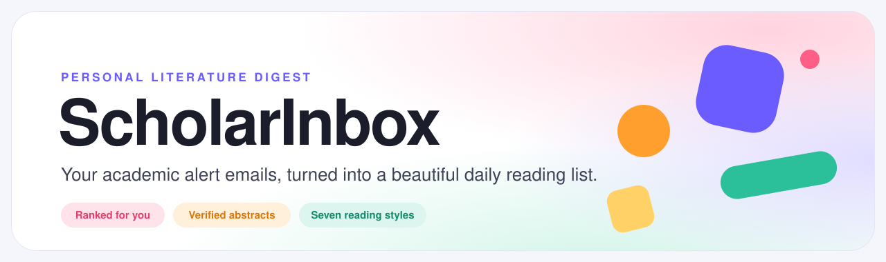
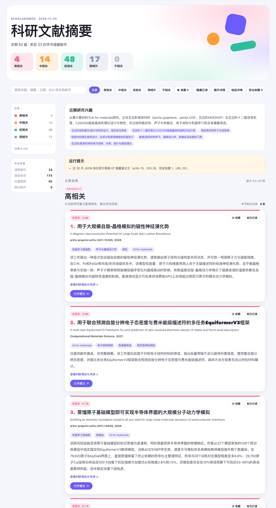
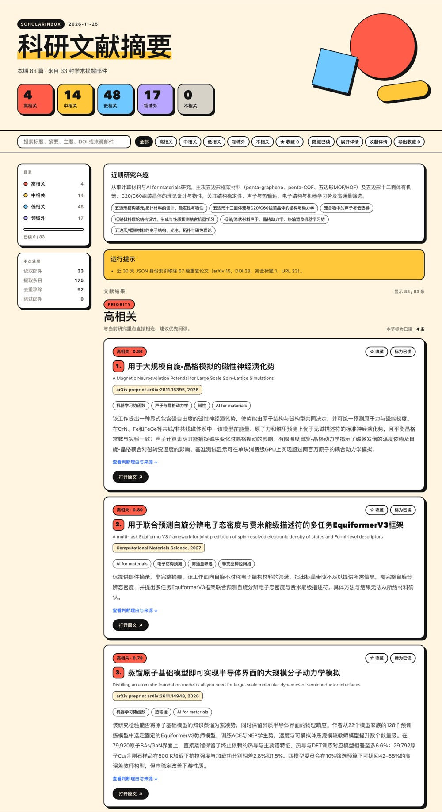
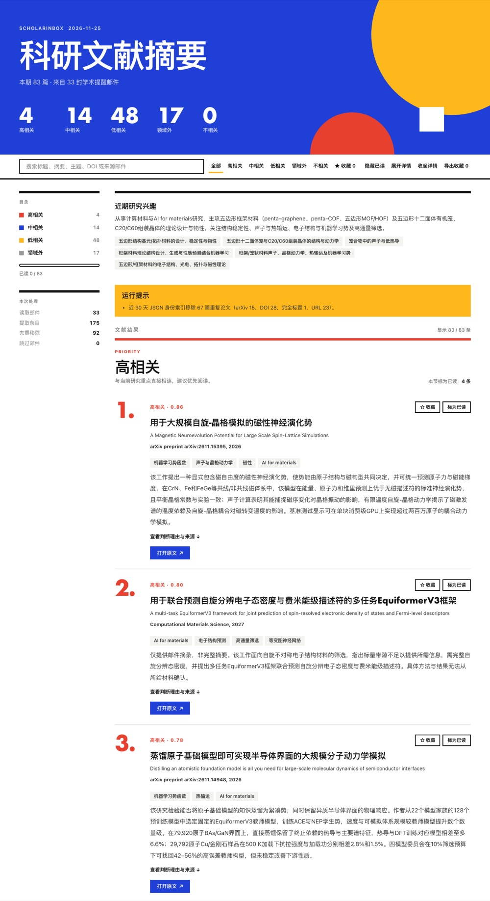
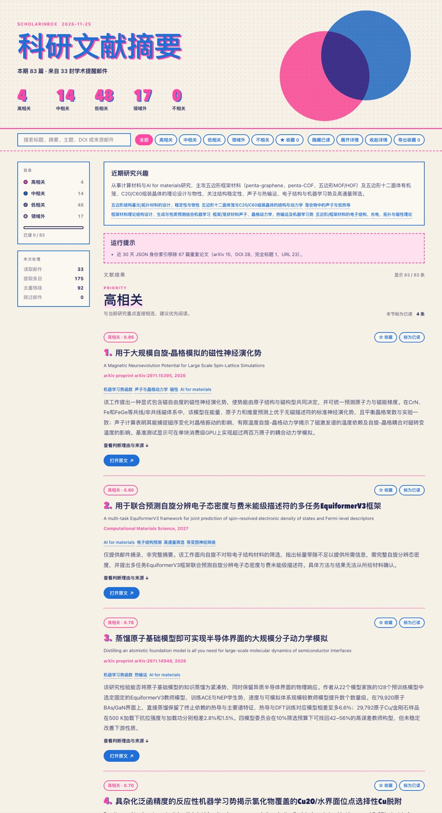
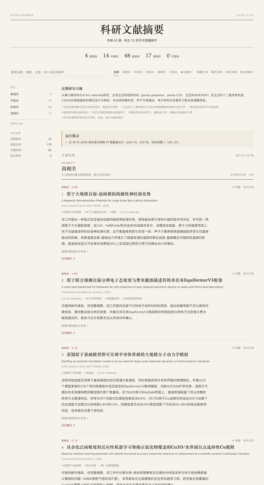
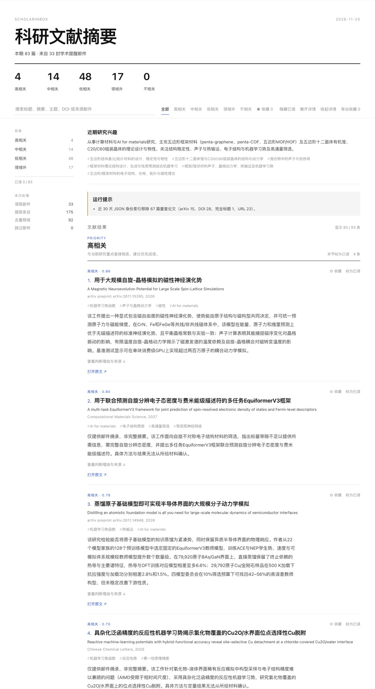
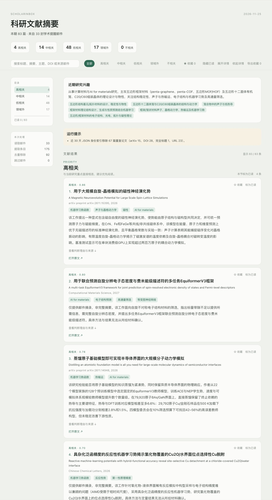
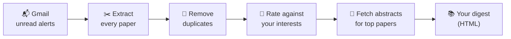

<div align="center">



<p>
  <a href="https://femisphere.github.io/ScholarInbox/examples/sample-digest.html"><b>✦ Live demo</b></a>
  &nbsp;·&nbsp; <a href="README.zh-CN.md">中文说明</a>
  &nbsp;·&nbsp; <a href="#-get-started-in-five-steps">Get started</a>
  &nbsp;·&nbsp; <a href="#-seven-reading-styles">Reading styles</a>
</p>

<p>
  
  
  <a href="https://github.com/FemiSphere/ScholarInbox/actions/workflows/tests.yml"></a>
  
  <a href="LICENSE"></a>
</p>

</div>

---

You follow a dozen Google Scholar alerts and journal tables of contents. Every week they pile up into a hundred unread emails — and the three papers that actually matter to *your* project are buried somewhere inside.

**ScholarInbox reads that inbox for you.** It pulls out every paper, removes the ones you have already seen, ranks the rest against a short note about your research, fetches the real abstract for the promising ones, and lays everything out as a calm, searchable reading page. You open one file, read the top of the list, and you are done.

> *Per aspera ad astra* — 循此苦旅，以抵星辰。

## ✨ What you get

<table>
<tr>
<td width="50%" valign="top">

**🎯 Ranked for your research**<br>
Write your interests in plain language. Every paper is sorted into *High · Medium · Low · Off-topic*, with a one-line reason. Papers outside your field are folded away so they never cost you attention.

</td>
<td width="50%" valign="top">

**📄 Real abstracts, not guesses**<br>
For the papers worth reading, ScholarInbox finds the original abstract (arXiv, Crossref, OpenAlex) and re-checks its rating — only when the paper's identity matches.

</td>
</tr>
<tr>
<td valign="top">

**🧹 No repeats, no noise**<br>
The same paper from three different alerts appears once. Papers you saw in the last 30 days are skipped. Marketing emails are filtered out.

</td>
<td valign="top">

**📚 A page that is pleasant to read**<br>
Search, filters, read/star marks, starred-paper export, image zoom — and seven visual styles to choose from. One self-contained HTML file that works offline.

</td>
</tr>
</table>

The digest is written in **Simplified Chinese** (titles and summaries), with the original English title always kept alongside.

## 🎨 Seven reading styles

Pick one in your settings, or switch any time from the footer of a digest. Your choice is remembered.

**Bright**

<table>
<tr>
<td align="center" width="25%"><br><b>Fresh</b> · default</td>
<td align="center" width="25%"><br><b>Pop</b></td>
<td align="center" width="25%"><br><b>Bauhaus</b></td>
<td align="center" width="25%"><br><b>Riso</b></td>
</tr>
</table>

**Academic**

<table>
<tr>
<td align="center" width="33%"><br><b>Editorial</b></td>
<td align="center" width="33%"><br><b>Swiss</b></td>
<td align="center" width="33%"><br><b>Calm</b></td>
</tr>
</table>

👉 **[Open the live demo](https://femisphere.github.io/ScholarInbox/examples/sample-digest.html)** — a real 83-paper digest; try the style switcher at the bottom.

## 🔄 How it works



Everything runs on your own computer and stays inside the project folder — even if you start it from somewhere else. Old digests, logs and caches are cleaned up automatically. Emails are only marked as read after a fully successful run, and are never deleted.

## 🚀 Get started in five steps

You need: **Python 3.12+**, the **Gmail** account that receives your alerts, and an **AI model key** (DeepSeek is recommended and inexpensive; any OpenAI-compatible service also works).

**1 · Install**

```bash
git clone https://github.com/FemiSphere/ScholarInbox.git
cd ScholarInbox
python -m venv .venv && source .venv/bin/activate      # Windows: .venv\Scripts\activate
python -m pip install -e .
```

**2 · Let the setup wizard ask you a few questions**

```bash
scholar-inbox init
```

It chooses your AI model, stores your key safely in a local `.env` file, and creates your settings and interests files.

**3 · Connect Gmail** (one time, about five minutes)

In [Google Cloud Console](https://console.cloud.google.com/): create a project → enable the **Gmail API** → create an **OAuth client ID** of type *Desktop app* → download it as `credentials.json` into the project folder. The first run opens your browser to approve access.

**4 · Tell it what you study**

Edit `research_interests.md` in plain language — no keyword syntax needed. The most important part is a short list of your **broad fields**: papers outside all of them are folded away as off-topic.

<details>
<summary><b>Examples from different fields</b></summary>

```markdown
## Broad fields
- Neuroscience
- Cognitive psychology

## What I'm working on
I study how sleep affects memory consolidation in adolescents, using EEG and behavioural tasks.

## Especially interested in
- Sleep spindles and slow oscillations
- Targeted memory reactivation (TMR)
```

```markdown
## Broad fields
- Development economics
- Applied econometrics

## What I'm working on
Impact evaluation of cash-transfer programmes in Southeast Asia.

## Especially interested in
- Randomised controlled trials, difference-in-differences
- Household consumption and labour supply
```

</details>

**5 · Check and run**

```bash
scholar-inbox doctor                     # checks everything — offline and free
scholar-inbox --sample --dry-run         # a demo digest from built-in sample emails
scholar-inbox --no-dry-run               # the real thing
```

Your digest appears in `outputs/`, and the terminal shows a clickable link to it.

## 📅 Everyday use

```bash
scholar-inbox --no-dry-run       # read new alerts, write today's digest, mark them as read
scholar-inbox --dry-run          # preview without touching your mailbox
```

The terminal shows each step as it finishes and ends with a short summary: how many papers in each level, how many abstracts were verified, and how many unread emails are left.

Your settings live in `config.local.yaml` (the wizard creates it). Every option, with comments in English and Chinese, is in [`config.example.yaml`](config.example.yaml):

```yaml
llm:
  preset: deepseek          # deepseek · openai_compatible · codex_cli
gmail:
  max_emails_per_run: 50
  mark_as_read: true        # after a successful real run
digest:
  theme: fresh              # fresh · pop · bauhaus · riso · editorial · swiss · calm
  max_high_relevance: 20
```

## ❓ Questions

<details>
<summary><b>Does it ever delete or change my emails?</b></summary>
<br>
It never deletes anything. It only marks processed emails as read — on a real run (<code>--no-dry-run</code>), when <code>mark_as_read</code> is on, and only if every core step succeeded. Otherwise your emails stay unread, so you can simply run again.
</details>

<details>
<summary><b>What leaves my computer?</b></summary>
<br>
Email text goes to the AI model you choose, to extract and rate papers. Paper DOIs and titles go to the free Crossref and OpenAlex services to find abstracts. Credentials stay in local files that are never committed; digests, logs and caches stay on your disk.
</details>

<details>
<summary><b>How much does it cost?</b></summary>
<br>
Only your AI model usage. With DeepSeek a typical run over a few dozen alert emails is small; abstract lookups through Crossref and OpenAlex are free. If a run has to be repeated, everything that already succeeded is reused.
</details>

<details>
<summary><b>Which emails does it understand?</b></summary>
<br>
Google Scholar alerts, and journal or publisher table-of-contents emails (Elsevier, ACS, Wiley, Springer, APS, RSC, Nature and many more). Long weekly digests are split and read in order.
</details>

## 🗂️ Project layout

```text
literature_digest/              the program (presets/ holds the AI model presets)
config.example.yaml             every setting, with comments
research_interests.example.md   a template for your interests
examples/                       the live-demo digest
docs/                           maintainer documentation (Chinese)
tests/                          offline test suite
```

Ideas and contributions are welcome — open an issue or a pull request. If you change the code, start with [`AGENTS.md`](AGENTS.md) and the [code map](docs/code-map.md), and run `python -B -m pytest -q` before submitting.

Released under the [MIT License](LICENSE).

<div align="center">
<br>
<sub>Made with care for everyone who has ever drowned in alert emails.</sub>
</div>
