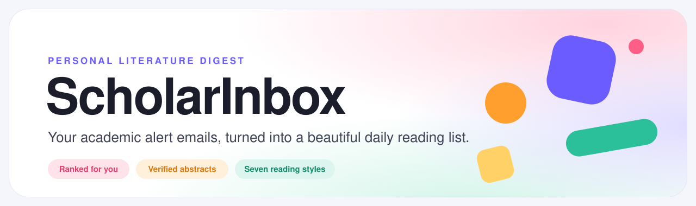
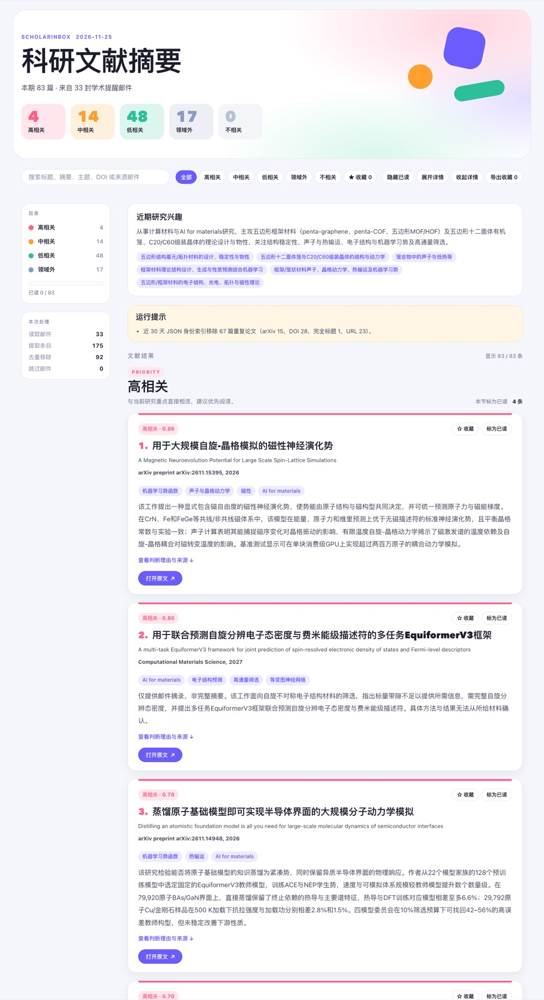
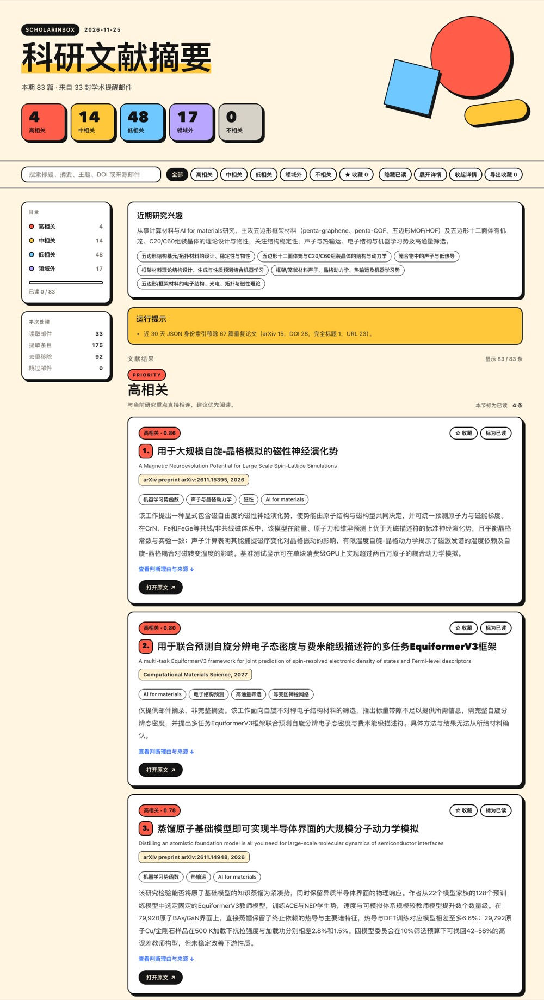
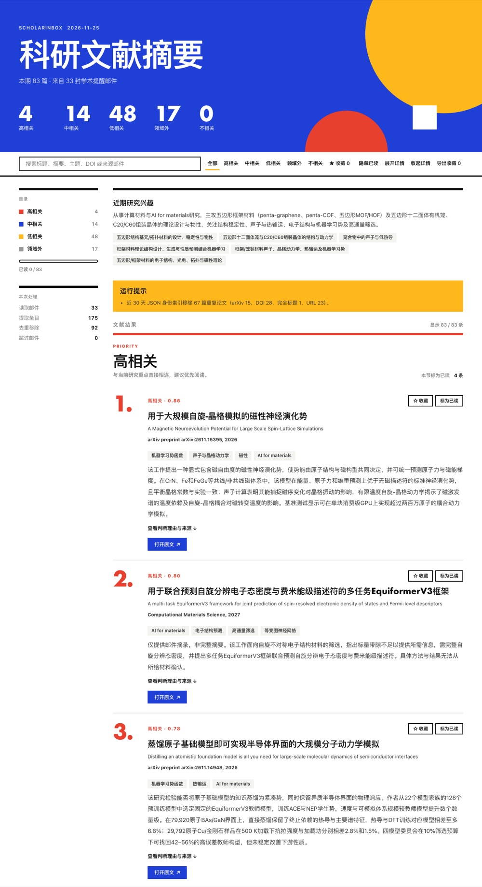
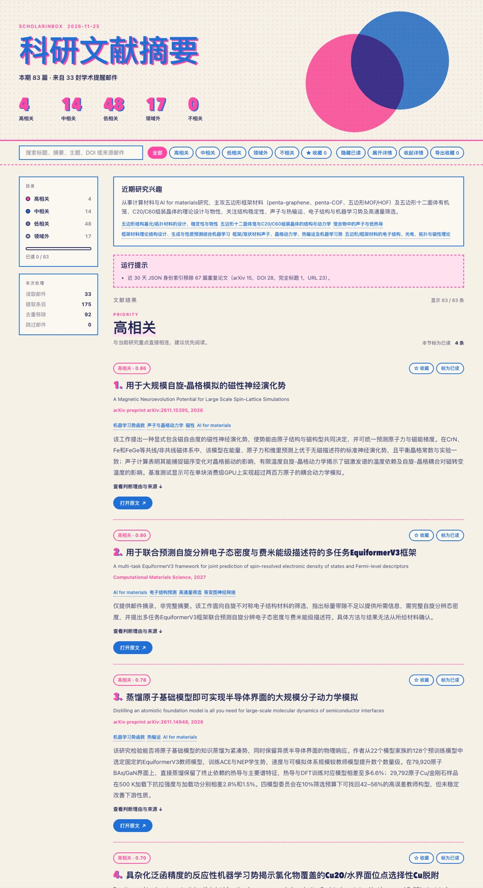
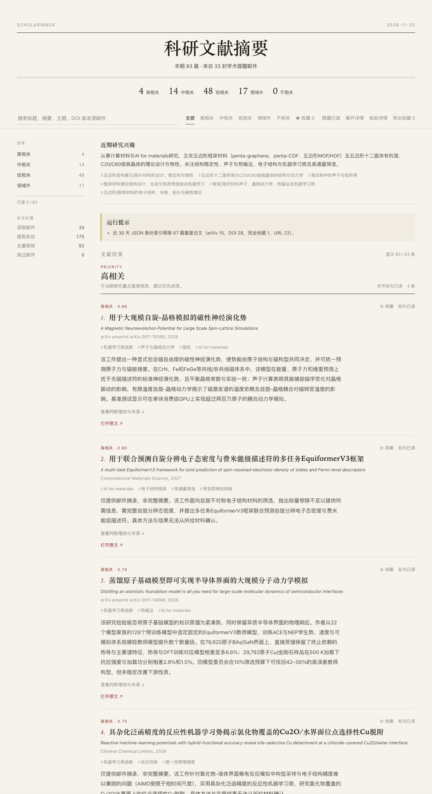
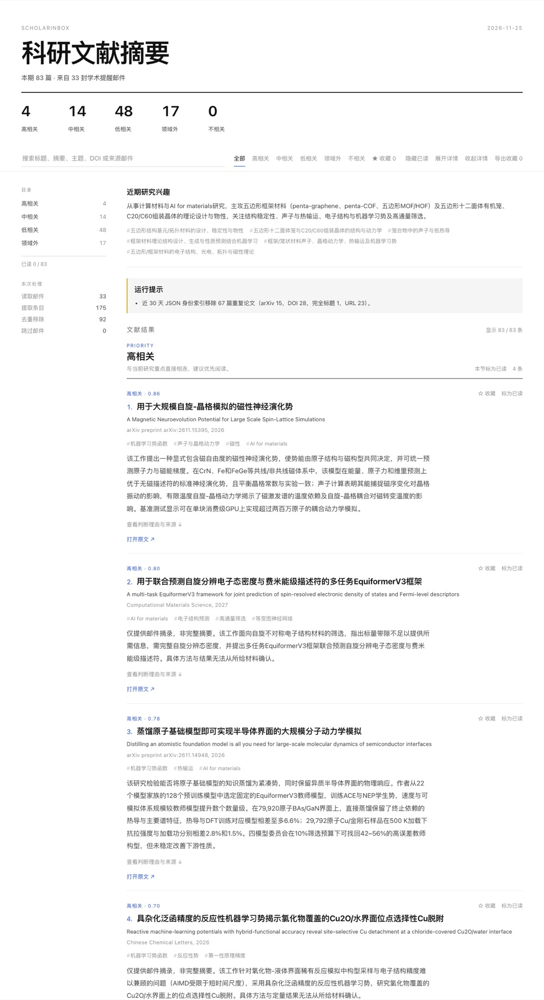
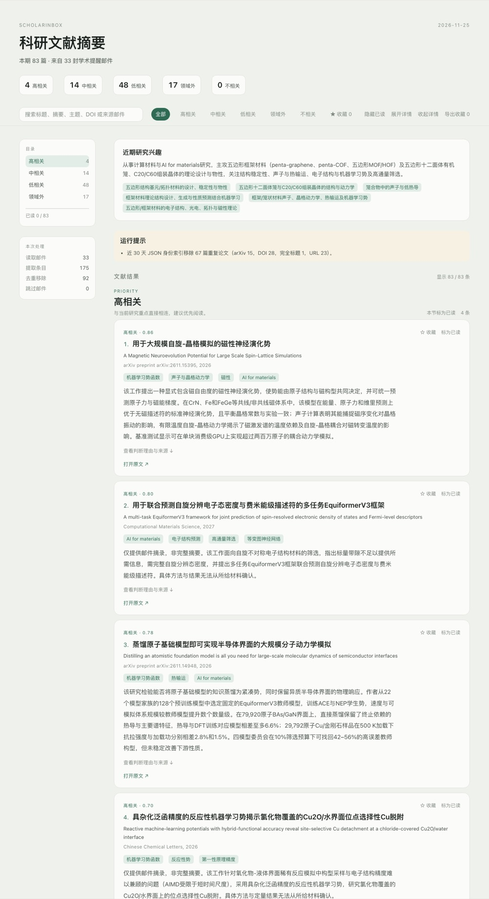
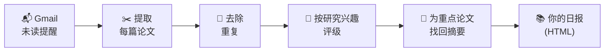

<div align="center">



<p>
  <a href="https://femisphere.github.io/ScholarInbox/examples/sample-digest.html"><b>✦ 在线样例</b></a>
  &nbsp;·&nbsp; <a href="README.md">English</a>
  &nbsp;·&nbsp; <a href="#-五步上手">五步上手</a>
  &nbsp;·&nbsp; <a href="#-七套阅读版式">阅读版式</a>
  &nbsp;·&nbsp; <a href="docs/README.md">维护文档</a>
</p>

<p>
  
  
  <a href="https://github.com/FemiSphere/ScholarInbox/actions/workflows/tests.yml"></a>
  
  <a href="LICENSE"></a>
</p>

</div>

---

你订阅了十几个 Google Scholar 快讯和期刊目录。一周下来，邮箱里堆起上百封未读邮件，而真正和**你的课题**相关的那三篇论文，就埋在其中某个角落。

**ScholarInbox 替你读这个邮箱。** 它把每封邮件里的论文都找出来，去掉看过的，按你写下的研究兴趣逐篇评级，为值得读的论文找来原始摘要，最后排成一份安静、可搜索的阅读页面。打开一个文件，从上往下读几篇，就完成了。

> 循此苦旅，以抵星辰。 —— *Per aspera ad astra*

## ✨ 你会得到

<table>
<tr>
<td width="50%" valign="top">

**🎯 按你的研究排序**<br>
用自然语言写下研究兴趣。每篇论文被分为“高 · 中 · 低相关 · 领域外”，并附一句理由。与你的大方向无关的论文会被折叠，不再占用注意力。

</td>
<td width="50%" valign="top">

**📄 真实摘要，而非猜测**<br>
对值得读的论文，自动从 arXiv、Crossref、OpenAlex 找回原始摘要并据此复评。只有确认是同一篇论文时才会采用。

</td>
</tr>
<tr>
<td valign="top">

**🧹 不重复，少打扰**<br>
同一篇论文出现在三封邮件里，只显示一次；近 30 天看过的自动跳过；推广邮件会被过滤。

</td>
<td valign="top">

**📚 读起来舒服的页面**<br>
搜索、筛选、已读与收藏、导出收藏、图片放大，以及七套视觉版式。整个日报是一个独立的 HTML 文件，离线也能打开。

</td>
</tr>
</table>

日报以**简体中文**呈现标题与概述，同时保留英文原题。

## 🎨 七套阅读版式

在配置里选一个默认版式，也可以随时在日报页面底部切换，选择会被记住。

**明亮系**

<table>
<tr>
<td align="center" width="25%"><br><b>清新 Fresh</b> · 默认</td>
<td align="center" width="25%"><br><b>波普 Pop</b></td>
<td align="center" width="25%"><br><b>色块 Bauhaus</b></td>
<td align="center" width="25%"><br><b>印刷 Riso</b></td>
</tr>
</table>

**学术系**

<table>
<tr>
<td align="center" width="33%"><br><b>期刊 Editorial</b></td>
<td align="center" width="33%"><br><b>极简 Swiss</b></td>
<td align="center" width="33%"><br><b>宁静 Calm</b></td>
</tr>
</table>

👉 **[打开在线样例](https://femisphere.github.io/ScholarInbox/examples/sample-digest.html)**：一份真实的 83 篇论文日报，可在页面底部切换版式。

## 🔄 工作流程



一切都在你自己的电脑上运行，所有文件都留在项目目录内（即使从别的目录启动也一样），旧日报、日志和缓存会自动清理。只有完整成功的正式运行才会把邮件标为已读，程序从不删除邮件。

## 🚀 五步上手

需要准备：**Python 3.12+**、接收提醒邮件的 **Gmail** 账号，以及一个 **AI 模型 API key**（推荐价格低廉的 DeepSeek，其他 OpenAI 兼容服务也可以）。

**1 · 安装**

```bash
git clone https://github.com/FemiSphere/ScholarInbox.git
cd ScholarInbox
python -m venv .venv && source .venv/bin/activate      # Windows: .venv\Scripts\activate
python -m pip install -e .
```

**2 · 回答引导向导的几个问题**

```bash
scholar-inbox init
```

向导会帮你选择模型，把 key 安全地保存在本地 `.env` 文件里，并生成配置和研究兴趣文件。

**3 · 连接 Gmail**（只需一次，约五分钟）

在 [Google Cloud Console](https://console.cloud.google.com/) 中：新建项目 → 启用 **Gmail API** → 创建类型为“桌面应用”的 **OAuth 客户端 ID** → 下载并保存为项目目录下的 `credentials.json`。首次运行会打开浏览器请你授权。

**4 · 写下你的研究方向**

用自然语言编辑 `research_interests.md`，不需要任何关键词语法。最重要的是写清 **大方向**：不属于任何大方向的论文会被折叠为“领域外”。

<details>
<summary><b>不同领域的写法示例</b></summary>

```markdown
## 大方向
- 神经科学
- 认知心理学

## 当前课题
研究青少年睡眠对记忆巩固的影响，主要使用脑电（EEG）和行为实验。

## 重点关注
- 睡眠纺锤波与慢波振荡
- 定向记忆再激活（TMR）
```

```markdown
## 大方向
- 发展经济学
- 应用计量经济学

## 当前课题
东南亚现金转移支付项目的政策效果评估。

## 重点关注
- 随机对照试验、双重差分
- 家庭消费与劳动供给
```

更完整的模板见 [research_interests.example.md](research_interests.example.md)。

</details>

**5 · 检查并运行**

```bash
scholar-inbox doctor                     # 离线检查配置是否齐全，不产生费用
scholar-inbox --sample --dry-run         # 用内置样例邮件生成演示日报
scholar-inbox --no-dry-run               # 正式运行
```

日报保存在 `outputs/`，终端会给出可点击的文件链接。

## 📅 日常使用

```bash
scholar-inbox --no-dry-run       # 读取新提醒、生成今日日报，并标为已读
scholar-inbox --dry-run          # 预览，不改动邮箱
```

终端会逐步显示完成的阶段，最后给出简短汇总：各级别论文数、核验到的摘要数，以及邮箱里还剩多少封未读。

日常设置写在 `config.local.yaml`（向导会生成）。全部选项及中英双语注释见 [`config.example.yaml`](config.example.yaml)：

```yaml
llm:
  preset: deepseek          # deepseek · openai_compatible · codex_cli
gmail:
  max_emails_per_run: 50
  mark_as_read: true        # 正式运行成功后标为已读
digest:
  theme: fresh              # fresh · pop · bauhaus · riso · editorial · swiss · calm
  max_high_relevance: 20
```

macOS 可用 `scripts/run_digest_macos.sh` 一键运行（自动定位环境、可设代理），Windows 用 `scripts/run_digest.bat`，详见 [快捷运行与自动化](docs/automation-and-shortcuts.md)。

## ❓ 常见问题

<details>
<summary><b>会删除或改动我的邮件吗？</b></summary>
<br>
从不删除。只会把已处理的邮件标为已读，并且需要同时满足：正式运行（<code>--no-dry-run</code>）、开启了 <code>mark_as_read</code>、所有核心步骤都成功。否则邮件保持未读，直接重跑即可。
</details>

<details>
<summary><b>哪些数据会离开我的电脑？</b></summary>
<br>
邮件文本会发送给你选择的 AI 模型，用于提取和评级论文；论文的 DOI 与标题会发送给免费的 Crossref、OpenAlex 服务以查找摘要。凭据只保存在本地且不会被提交；日报、日志和缓存都留在你的硬盘上。
</details>

<details>
<summary><b>费用大概多少？</b></summary>
<br>
只有 AI 模型的调用费用。用 DeepSeek 处理几十封提醒邮件，开销很小；通过 Crossref 和 OpenAlex 查摘要是免费的。如果需要重跑，已经成功的部分会直接复用。
</details>

<details>
<summary><b>支持哪些邮件？</b></summary>
<br>
Google Scholar 快讯，以及各出版社、期刊的目录邮件（Elsevier、ACS、Wiley、Springer、APS、RSC、Nature 等）。较长的周报会按顺序分块读取。
</details>

## 🗂️ 目录结构

```text
literature_digest/              程序源码（presets/ 为内置模型预设）
config.example.yaml             全部配置项及注释
research_interests.example.md   研究兴趣模板
examples/                       在线样例日报
docs/                           维护文档（docs/README.md 为入口）
tests/                          离线测试
```

欢迎提出建议或贡献代码，可以开 issue 或 pull request。修改代码前请先阅读 [`AGENTS.md`](AGENTS.md) 和 [代码地图](docs/code-map.md)，提交前运行 `python -B -m pytest -q`。

本项目以 [MIT 许可证](LICENSE) 开源。

<div align="center">
<br>
<sub>献给每一位被提醒邮件淹没过的研究者。</sub>
</div>
